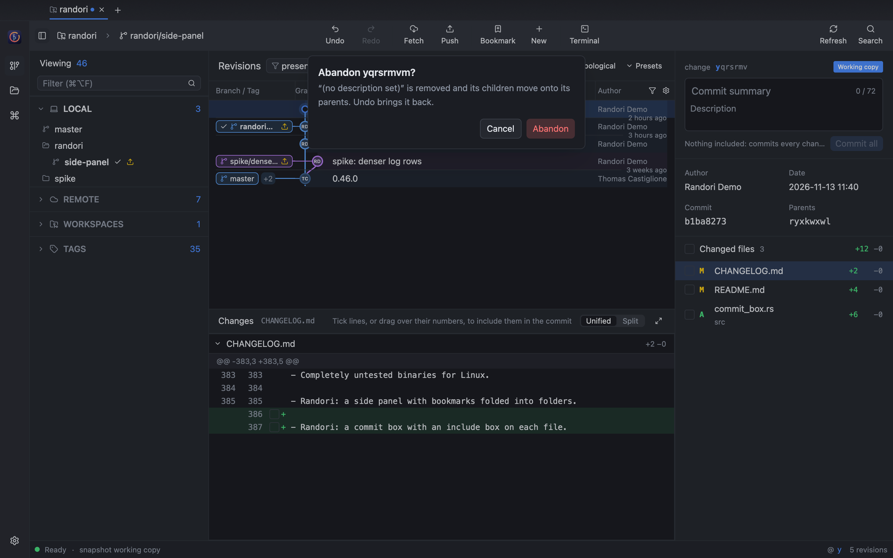

<p align="center">
  
  <br>
  <strong>Randori</strong>
  <br>
  A GPU-accelerated desktop client for <a href="https://github.com/jj-vcs/jj">Jujutsu</a>
</p>


Randori is a native desktop client for the Jujutsu version control system. It
pairs the jj engine from [GG](https://github.com/gulbanana/gg) with a UI built
on [GPUI](https://github.com/zed-industries/zed/tree/main/crates/gpui) and [GPUI Kit](https://github.com/longbridge/gpui-kit),
so the whole application is Rust, rendered on the GPU, with no webview.

The name comes from jujutsu practice: *randori* is free-form sparring, where
you move, split and recombine freely. That is how jj treats history.

> **Status:** early development. Randori reads and edits jj workspaces —
> tabs, graph log, diffs, describe, new, edit, abandon, bookmarks, rebase by
> drag and drop, file and line squashes, file and line splits, push, fetch,
> undo and redo, a command palette, appearance settings and the GitHub pull
> requests of the workspace.
> Conflicts open in your merge tool; an in-app conflict editor is not built yet.

## The window

| Region | What it shows |
| --- | --- |
| Tabs | One tab per jj workspace, like Fork or GitKraken. `+` (or `⌘O`) opens more; the open tabs come back on the next launch |
| Toolbar | Laid out as GitKraken's. At the left, the **workspace** and **bookmark** switchers (like GitKraken's repository and branch pickers) and a **conflicts** count; in the middle, **Undo**, **Redo**, **Fetch**, **Push**, **Bookmark**, **New** and **Terminal**, each icon over its name (jj has no stash: work in progress is a change already, so **New** stands where GitKraken has Stash and Pop); at the right, **Refresh** and **Search** (find a commit, below). In a narrow window a long bookmark name ends in an ellipsis rather than running under the commands; its tooltip has it whole |
| Rail | Revisions, Open, the command palette (`⌘P`, as in GitKraken) and Settings (below) |
| Side panel | As GitKraken's: a **filter** (`⌘⌥F`) over every section, then **Local**, **Remote** (by remote), **Workspaces** (jj's worktrees), **Pull requests** of the workspace's GitHub remote (below) and **Tags**, each folding under a header with its count. It lists every bookmark and tag of the repository, not only those the log has loaded, folded into folders at the `/` of their names (`release/2.0.0` under **release**; remote bookmarks under their remote), and a ✓ marks the bookmark you are on, whose folders open by themselves. Hover one for its full name and a **⋮** with its commands (the same as a right-click): check out, push, move, rename, track, copy its name, commit or change id, delete. Click one to select its revision (one the log does not show widens the revset to take it in), double-click to switch to it (`jj new` on it), drag it onto a revision to move it |
| Revisions | Branch / tag, graph, description and author columns, GitKraken style (the change id column is off until you turn it on): drag a header's edge to resize a column (double-click it for the default width); the widths are remembered and the graph fits its lanes until you size it. The ⚙ at the header's right end shows or hides the optional columns and resets the widths; the funnel beside it filters by author, dimming the other revisions as GitKraken's does. Instead of a time on every row, a hairline and a small label on it ("3 hours ago", "2 weeks ago", "a month ago") mark where each age group starts; the inspector has the exact date. The working copy has none: its time is when it was last snapshotted, "just now" whenever the log is read. Narrow, the author column shows avatars only. Each branch keeps one colour from its tip down, and its rows are tinted in it. A revision is its author's round avatar (GitHub picture or initials); a dimmer ring marks immutable revisions, small dots are merges and the hollow ring is the working copy (`@`). Local bookmarks that are not pushed carry an upload mark. Right-click for revision commands; drag a revision onto another to rebase it there |
| Changes | Diff of the selected file, unified or split, with line numbers and word-level highlights. Split puts the parent's version on the left and wraps long lines so both sides stay in view; drag the boundary between them to resize the sides, double-click it to even them. The palette and the View menu do the same from the keyboard; used on a unified diff, they switch it (and the layout diffs open in) to split. Double-click a file (or `⇧⌘D`) for its full view |
| Inspector | The selected revision: change id, an editable description in one box of two fields, a one-line summary and the description under it, as GitKraken's (immutable history stays read-only; jj keeps them as one message, with a blank line between), author, date, commit, parents and the changed files. Right-click a file to squash it into the parent, discard it, or open it in your diff or merge tool; drag it onto a revision to move it there |
| Terminal | Your shell at the bottom of the tab (below) |
| Status bar | Worker state, the running jj operation and its progress, the latest operation (what the toolbar's **Undo** undoes), the working copy and the number of loaded revisions |

The **workspace** switcher lists the open tabs, then recently opened
workspaces (`gg.ui.recent-workspaces`, the list GG keeps; off with
`gg.ui.track-recent-workspaces = false`), then **Open…**. The **bookmark**
switcher shows the bookmark nearest to the working copy; jj has no current
branch. Picking another bookmark (`⇧⌘B`) starts a new change on it, `jj new
<bookmark>`, the closest jj has to a checkout. The conflict count is every
mutable revision with a conflict (`conflicts() & mutable()`), loaded or not;
clicking it goes to the next one, switching to **All branches** when it is not
loaded.

After New, Edit or a bookmark switch, Randori snapshots once and checks
whether the new working copy picked up files. That happens when the revision
you move to does not ignore files the previous one ignored, an older
`.gitignore` meeting a build folder: jj then tracks them
([jj #5596](https://github.com/jj-vcs/jj/issues/5596)). A notification lists
them; **Ignore locally** adds them to `.git/info/exclude` (one line per new
folder, never committed) and untracks them, leaving the files on disk.

**By date** lists revisions newest first across branches, like GitKraken's
graph or `git log --date-order`, instead of jj's order, which finishes one
branch before the next. It orders by commit time and keeps every parent below
its children. (Not by the order jj recorded the commits in: for a repository
imported from git that is the import order, and tags fetched later would come
first.) The choice
is remembered for every tab (palette: **List revisions by date** / **Group
revisions by branch**). By date, the age labels follow the commit time too, so
a rebased old change sits with the day it was rewritten.

The log loads a page of revisions at a time (`gg.queries.log-page-size`, 1000
by default, as GitKraken starts with 2000) and the next one as you scroll,
while 200 rows are still to go, so the history scrolls on to its first commit.
jj's root commit (`zzzzzzzz`, empty and dated 1970) gets no row, as nothing
sits under the first commit in GitKraken.

**Mine** is jj's own log (`revsets.log`): your changes that are not in trunk
yet, and trunk. Changes on other people's branches are immutable to jj and stay
out of it. **All branches** shows every visible commit (`all()`), every branch
and tag like GitKraken's graph. The last scope you pick is remembered, and a
revset you type selects neither.

The revset field over the revisions (the funnel, `/` or `⌘L`) chooses which
revisions the log shows; it is not a search. A revset jj cannot use leaves the
log as it was and says why under the field. Where the revisions are narrow,
**Mine** / **All branches**, the order and **Presets** move to a second line
under it.

**Search** in the toolbar (`⌘F`) finds a commit the way GitKraken's does: a
bar over the revisions that matches its text against the loaded revisions'
descriptions, authors, change and commit ids and bookmark names, counts them
("3 of 47"), steps through them with Enter and `⇧Enter` (or its arrows) and
dims the rest. Stepping past the last match loads the next page while there is
one.

Each tab runs its own jj worker thread (jj-lib is not thread-safe), so a slow
fetch in one workspace never blocks another. Edits made outside Randori, in an
editor or with the jj CLI, show up when the window comes back to the front:
Randori asks jj to snapshot the working copy and reloads, keeping the rows you
had loaded and your scroll position.

### Editing

Every command is one of GG's jj mutations, so the rules are jj's own:
immutable revisions are refused with a warning, `Undo` steps back through the
operation log, and git credentials are asked for when a remote needs them.

| Command | How |
| --- | --- |
| New change on the selection | `N`, the toolbar's **New**, or the context menu |
| Edit (make it the working copy) | `E` |
| Describe | `D` to focus the inspector editor, `⌘↩` to save |
| Create bookmark | `B`, then type a name and press Enter |
| Abandon | `⌫` / `Delete`, confirmed in a dialog |
| Duplicate, back out | Context menu |
| Rebase | Drag a revision onto its new parent, or press `R`, choose the parent with `↑` `↓` and press Enter |
| Move a bookmark | Drag it from the side panel onto a revision, or right-click it there → **Move to…**, choose the revision with `↑` `↓` and press Enter. Unlike `jj bookmark move`, a move backwards or sideways needs no `--allow-backwards`; Undo takes it back |
| Squash a file into the parent | Right-click it in the inspector |
| Move a file to any revision | Drag it from the inspector onto the revision, or right-click → **Move to revision…** |
| Discard a file's changes | Right-click it in the inspector, confirmed in a dialog |
| Squash lines into the parent | In a revision other than the working copy, point at a changed line and click the **+** beside it: that line moves into the parent. For several, select them in the diff (drag over the line numbers), then **Squash into parent**: only the selected lines move, so they are to be in one hunk |
| Split lines into a new commit | Select lines in the diff, then **Split off…** and describe them: as `jj split -i` with those lines picked, the revision keeps its change id and the selected lines, with that description, and a new revision on it has the rest, with the old description, the bookmarks and (for the working copy) `@` |
| Split files into a new commit | `⌘`-click or `⇧`-click files in the inspector to pick them, then right-click → **Split into a new commit…** and describe it, the same way (`jj split <paths>`). In the working copy, `⌘`-click and `⇧`-click tick the files' boxes instead, and **Split off** in the commit box splits what is ticked |
| Resolve a conflict | Right-click the conflicted file → **Resolve in merge tool** (`ui.merge-editor`) |
| Anything else | `⌘P` opens the command palette |
| Push | `⌘⇧P` pushes the selection's bookmarks (an untracked bookmark goes to `origin`, or the only remote) |
| Fetch | `⌘⇧F` fetches every remote |
| Undo / redo | **Undo** and **Redo** in the toolbar, or the palette. As in GG and `jj undo`, Undo undoes the repository's latest operation whoever made it (the jj CLI, VS Code, a snapshot), which the status bar names; it snapshots first, so file changes it picks up are what is undone |

### Committing

jj has no index, and Randori adds none: what you see in `jj log` is all
there is. Select the working copy and the inspector shows the next commit: a
message (summary and description, Enter moving from one to the other) and
the working copy's changed files, each with a box for whether the commit
includes it, as GitHub Desktop has them. The message box starts with the
working copy's description, if it has one, so committing everything keeps it.

| To | Do |
| --- | --- |
| Include a file | Tick its box, or `⌘`-click it (`⇧`-click for the files from the selected one to it); the box over the list includes every file, or none |
| Include lines | In the working copy's diff, tick the box beside a changed line; for several, drag over their line numbers and click **Include lines** (**Leave lines out** when they are all in). A file with some of its lines in shows a dash |
| Include a hunk | In the working copy file's full view, **Include hunk** under it |
| Commit | Type the message and click **Commit** (or `⌘↩`). With nothing included, every change is committed, as `jj commit` does. With some, those are, as `jj commit -i` does: the working copy keeps its change id, its bookmarks and the changes included, gets the message, and a new working copy on it, undescribed, has the rest |
| Split off | With some changes included, type a message and click **Split off**, as `jj split` does: what is included keeps the change id and gets the message, and the working copy (a new change) keeps the rest, its description and its bookmarks. For peeling a change off work you go on with |

What is included is the tab's own until the commit: ticking boxes writes
nothing to the repository, and the commit is one jj operation, which Undo
takes back. The files on disk never change. A line edited after it was
included is left out again (the commit box says so), so a commit never takes
lines other than those you ticked.



### Full file view

Double-clicking a changed file, the expand button above the diff, `⇧⌘D`, or
**Open full view**, **Blame** and **File history** in the file's context menu
open the file on its own, in the place of the revisions and the diff (`Esc`
or the × at the header's right end goes back). The header has two rows, as
GitKraken's: the file's path (the directory gives way before the name), then
the view's controls, which wrap where the window is narrow:

| Part | What it shows |
| --- | --- |
| Diff | The file's diff in that revision, unified or split. Under every hunk, **Squash into parent** (**Include hunk** in the working copy) and **Discard hunk** (the parent's lines back; Undo undoes it). Drag over line numbers for **Squash into parent** and **Split off…** of those lines, as in the inspector's diff. `⌥↑` `⌥↓` move between changes |
| File | The whole file as it is in that revision, with line numbers |
| Blame | Each line with the revision that last changed it, the way `jj file annotate` finds it; click a revision to see its diff of the file. It is computed on a load of its own, so the tab stays usable while a long history is walked |
| History | Every revision that changed the file among the ancestors of the one you opened, in the side panel's place; pick one to see the file as it was there |


### Terminal

The toolbar's terminal button or `` ⌃` `` opens your shell at the bottom of the
tab, in the workspace's folder, as GitKraken does. It is a real terminal: your
login shell with its prompt and aliases, colours, full-screen programs (`less`,
`vim`, `jj split -i`), scrollback, a mouse selection to copy, and input methods
for Korean, Japanese or Chinese. The shell keeps running while the panel is
hidden; when it exits, Enter starts a new one.

When a command records a jj operation (`jj new`, `jj squash`, `jj git fetch`,
even a snapshot by `jj st`), the revisions reload on their own. In a
colocated repository so does a `git` command that moves a branch or `HEAD`
(`git commit`, `git checkout`): Randori snapshots to import it, so this needs
snapshots on (**Snapshot when Randori comes to the front** set to Automatic or
Always; with Never, the change shows after the next jj command). Reload
(`⌘R`) also picks up what the jj CLI, or `git` in a colocated repository, did
elsewhere.

| Keys | In the terminal |
| --- | --- |
| `⌘C` / `⌘V` (`Ctrl+Shift+C` / `Ctrl+Shift+V`) | Copy the selection / paste (bracketed, so pasted lines do not run one by one) |
| `⌘K` | Clear the screen and the scrollback |
| `Esc`, `Ctrl` keys | Go to the shell, not to Randori |

Powerline prompt arrows are drawn by the terminal itself, so they need no
patched font; other prompt symbols use an installed Nerd Font when there is
one.

### Settings

`⌘,` (or the rail's Settings button, or **Randori → Settings…**) opens the
Settings window, as Fork has one: pages on the left, a search above them.
A change applies at once, with no Save button. Randori's own preferences are
saved with its session; the jj ones go to your jj user config (the file
`jj config set --user` edits), so the jj CLI and GG agree with Randori. A jj
write that fails says so instead of pretending the setting changed.

| Page | Setting | Saved in | Effect |
| --- | --- | --- | --- |
| General | Theme | session | Light, dark or follow the system |
| | Order | session | Topological (one branch at a time, as `jj log`) or by date (newest first across branches); the revisions' header switches it too |
| | Mark tabs with changes | session | A dot on a tab whose working copy changes files |
| | Source folders | session | The workspace picker lists the jj repositories in these folders, two levels down (not inside hidden, `target` or `node_modules` folders) |
| | Fetch automatically | session | `jj git fetch` for every open tab every 5, 15, 30 or 60 minutes; a fetch that fails (no network, a password) is skipped quietly |
| Revisions | Columns | session | Show or hide Branch / Tag, Change (off at first) and Author, as the ⚙ over the list does; the graph and the description always show |
| | Mark bookmarks that are not pushed | `gg.ui.mark-unpushed-bookmarks` | Upload mark on local bookmarks that moved since their push, or that no remote tracks |
| Diff | Diffs open as | session | Unified or split; the diff header's switch changes it too, in the changes panel and the full file view alike. The split's divider position is saved too |
| | Mark changed lines with | session | `+` and `−` signs, a coloured bar, or colour only |
| | Syntax highlighting | session | On or off |
| | Code font, size | session | The font of diffs, the file view and change ids, among the installed code fonts |
| Describe | Subject length | session | The summary field counts its characters against the second limit and colours the count past 50 and 72 (or your limits) |
| | Issue links | session | One rule a line, a regular expression and a URL with `$0` for the match (`MELON-\d+ https://…/browse/$0`); matches in descriptions and pull requests become links |
| jj | Name, Email | `user.name`, `user.email` | Who new changes are by; open tabs load their workspace again to pick them up |
| | Snapshot when Randori comes to the front | `gg.queries.auto-snapshot` | Automatic (off in repositories over `gg.queries.large-repo-heuristic`, 100k commits), always or never |
| Integration | Terminal: Open | session | The terminal panel, or a terminal application (Terminal, iTerm, Ghostty…) opened in the workspace's folder |
| | Terminal: Font, size | session | The terminal panel's font, else the code font |
| | Merge tool, Diff tool | `ui.merge-editor`, `ui.diff-formatter` | jj's tools for "Resolve in merge tool" and "Open in diff tool" (and the jj CLI); open tabs load their workspace again |
| | GitHub | session | Pull requests and avatars on or off, and how often the list refreshes |

**Presets** lists GG's revset presets: the `[gg.presets]` table of your jj
config, or GG's own (tracked bookmarks, remote bookmarks, all revisions) when
it is empty. Kebab-case names become titles (`local-bookmarks` → "Local
Bookmarks").

### Pull requests

When a workspace has a GitHub remote (`origin`, or else the first remote on
github.com or a GitHub Enterprise host), the side panel lists its open pull
requests, newest activity first: author, number and title, head → base branch,
the review decision and the checks of the head commit. Click one to open it, or
its link to open it on GitHub. The list refreshes on the interval chosen in
Settings (every minute by default), when the window comes back to the front (at
most every 30 seconds) and from **Refresh pull requests** in the palette.

An open pull request takes the place of the revisions, the diff and the
inspector, as its page on GitHub looks (`Esc` goes back):

| Tab | What it shows |
| --- | --- |
| Overview | The description (Markdown, with task lists, tables and code) and the conversation: comments, reviews, pushed commits, merges. Beside it the review decision, reviewers and their reviews, assignees, labels, checks (failing first) and the branch, with **Show in the graph** to select the head revision |
| Files changed | The changed files and their diff, unified or split (the divider moves as in the changes panel), with review threads under the lines they are on. Click a file to go to it |

The view follows the pull request: when the list refreshes and GitHub has
updated it, the view reloads, and so does its diff if new commits were pushed.

The diff runs from the merge base of the base and the head to the head, as
GitHub's does. Randori computes it from the repository when both commits are in
it (a branch of the same repository, fetched): nothing is cut short. A pull
request from a fork, or one not fetched yet, shows GitHub's diff instead, which
GitHub may refuse for a very large pull request.

Avatars are GitHub's, as GitHub shows them: an account's picture, or the
generated one (an identicon) of an account without a picture. The first pull
request query brings the authors of recent commits on the default branch; any
other author in the loaded revisions is asked about by one of their commits,
once. Authors whose commits GitHub does not have
(not pushed) get their initials.

Randori uses the token you already have: `GH_TOKEN` or `GITHUB_TOKEN` for
github.com, `GH_ENTERPRISE_TOKEN` only for the Enterprise host `GH_HOST` names,
or else the one the GitHub CLI stored for that host (`gh auth token`). A remote
that merely looks like GitHub Enterprise gets no token. It is kept in memory,
never written or logged, and sent only to that host's GraphQL API over HTTPS.
Without one the section shows how to sign in (`gh auth login`); nothing else
needs it.


### Keyboard

| Keys | Where | Action |
| --- | --- | --- |
| `↑` `↓` / `k` `j` | Revisions | Select the previous / next revision; the next page loads before the end |
| `Home` / `End` | Revisions | First / last loaded revision |
| `R` | Revisions | Pick a new parent for the selection (Enter applies, Esc cancels; other commands wait until you do) |
| `/` | Revisions | Edit the revset filter |
| `⌘L` (`Ctrl+L`) | Workspace | Edit the revset filter |
| `⌘F` (`Ctrl+F`) | Workspace | Find a commit; `Enter` / `⇧Enter` next / previous match, `Esc` closes |
| `⌘⌥F` (`Ctrl+Alt+F`) | Workspace | Filter the side panel |
| `Esc` | Workspace | Back to the revision list |
| `⌘R` (`Ctrl+R`) | Workspace | Reload, with what jj recorded outside Randori |
| `` ⌃` `` | Workspace | Show or hide the terminal |
| `⌘B` (`Ctrl+B`) | Workspace | Show or hide the side panel |
| `⌘O` (`Ctrl+O`) | Window | Open a workspace in a new tab |
| `⌘W` (`Ctrl+W`) | Window | Close the tab; with no tab open, close the window |
| `⌘Q` (`Ctrl+Q`) | Anywhere | Quit (asks first when descriptions are unsaved). Closing the window quits too |
| `Ctrl+Tab` / `Ctrl+Shift+Tab` | Window | Next / previous tab |
| `⌘P` (`Ctrl+P`) | Window | Command palette |
| `⌘,` (`Ctrl+,`) | Window | Settings |
| `⇧⌘D` (`Ctrl+Shift+D`) | Workspace | Full view of the selected file |
| `⇧⌘B` (`Ctrl+Shift+B`) | Workspace | Start a new change on a bookmark |
| `⌥↑` / `⌥↓`, `[` / `]`, `Esc` | Full view | Previous / next change, previous / next file, back to the revisions |

On Linux and Windows, `⌘` is `Ctrl`. On macOS the menu bar has the same
commands (Randori, File, View, Window), with Hide (`⌘H`) and Services.

The layout follows the professional workstation style of
[Longbridge Pro](https://longbridge.com/desktop), the application GPUI Kit was
extracted from: panels told apart by their shade instead of cards (as in
GitKraken, the log darkest, the side panels a step lighter, the toolbar the
lightest), a narrow navigation rail, dense rows with stable columns, and an
inspector beside the work area. Colors come only from theme tokens, which
`crates/randori/src/theme.json` sets over gpui-kit's, so the light theme works
unchanged.

<details>
<summary>Light theme</summary>


</details>

## Running

Randori needs Rust 1.99.1, pinned in `rust-toolchain.toml` (jj-lib 0.46 and
GPUI both require a recent compiler; rustup installs it on first build), and
git 2.42 or newer for jj's git operations. If an older git comes first on
`PATH`, point jj at a newer one; Randori reads the same setting:

```sh
jj config set --user git.executable-path /opt/homebrew/bin/git
```

### From source

```sh
cargo run -- /path/to/workspace /path/to/another   # each opens in a tab
```

This is the development build: unoptimized, and a bare executable. Don't
double-click `target/*/randori` in Finder; macOS runs a bare executable inside a
Terminal window. Build the app bundle below to launch Randori like any other
Mac app.

### As a Mac app

```sh
script/bundle-macos.sh           # target/release/Randori.app
script/bundle-macos.sh --dmg     # also target/release/Randori.dmg (drag to Applications)
open target/release/Randori.app
```

The script needs only cargo and the macOS command-line tools (`codesign`,
`hdiutil`): it builds the release binary, writes `Info.plist`, adds the icon
and signs the bundle ad hoc, which is enough to run it on your own Mac. Giving
the app to other people needs a Developer ID signature and notarization
instead; Gatekeeper refuses ad-hoc signed apps downloaded from the internet.

The release profile (`Cargo.toml`) uses thin LTO, a single codegen unit and
strips symbols, and the app embeds only the icons it draws (`assets.rs`)
instead of the whole Lucide set:

| Build | Size |
| --- | --- |
| Release, default profile, every icon | 47.7 MB executable |
| Release, used icons only | 46.7 MB executable |
| Release, LTO + `codegen-units = 1` + strip | 29.4 MB executable |
| The same, with the HTTP client for GitHub | 32.3 MB executable |
| `Randori.dmg` (compressed disk image) | 15.8 MB |

A release build takes about three minutes on an M-series Mac; `cargo run`
stays fast because the debug profile is unchanged.

Released builds for macOS (Apple silicon), Windows and Linux are on the
[Releases](https://github.com/jeonsu0609/Randori/releases) page, signed ad hoc
(macOS) or not at all (Windows): open the app with Open in its context menu
the first time.

Opening a folder that is not a jj repository offers **Create a jj repository
here** (colocated with git when the folder already is one) and **Try again**
(`⌘R`).

| Option | Effect |
| --- | --- |
| `--revset <query>` | Start with this revset instead of the workspace default |
| `--light` | Use the light theme |
| `--check` | Open the workspace through the worker, print a summary and exit (no window) |
| `--select-row <n>` | Select the n-th log row once loaded |
| `--size <WxH>` | Open the window this size in points, e.g. `1000x700` |
| `--screenshot <png>` | Render the first screen offscreen and exit; needs `--features screenshot` |
| `--keys <k1,k2,…>` | With `--screenshot`: press these keys first through the real key bindings, e.g. `down,j,end`; `action:randori::SquashFile` runs an action the way a menu item does; `click:X;Y`, `cmdclick:X;Y` (with ⌘), `rclick:X;Y`, `dblclick:X;Y` and `drag:X1;Y1;X2;Y2` use the mouse at window points, or at `@name`, the middle of an element the app marks (e.g. `click:@summary`, `click:@include:a.txt`; `@line:new:2-25+0` is 25 points left of it), `move:X;Y` hovers, `scroll:X;Y;DY` turns the wheel, and `bench:X;Y;DY;N` turns it N times and prints how long each frame took to draw (median and slowest) |

The screenshots above were produced with, for example:

```sh
cargo run -p randori --features screenshot -- \
  --size 1440x900 --select-row 2 --keys 'move:900;600' \
  --screenshot doc/randori/first-screen.png /path/to/workspace
```

The sample workspace is a clone of GG with three extra changes on two
bookmarks and a working copy that changes three files, made under a
placeholder identity (`JJ_USER="Randori Demo"`, also `user.name` in a jj
config of its own through `XDG_CONFIG_HOME`). Its `origin` points away from
GitHub, so the pull requests section stays empty. The `move:` step puts the
pointer over empty space, where it hovers nothing, and gives the first frame a
redraw. Screenshot runs never touch your saved tabs.

`script/ui-flow-test.sh` drives the commit flow through the app the same way
(a summary typed and `⌘↩` with nothing included; a summary, Enter, a
description, saved as jj saves it; every change included and left out,
which writes nothing; a file's box ticked; a file `⌘`-clicked; two of four
files ticked; a file split off a described, bookmarked working copy; two
line numbers dragged over and Include lines clicked;
an unchanged description not saved again) on a throwaway repository and
checks what jj recorded. CI runs it on macOS, and builds
Randori for Windows.

## How it is built

```text
crates/randori   app_view       tabs, rail, palette, settings, saved session
                 repo_view      one workspace: state, loading, selection, keys
                   actions_bound  each of the tab's actions bound to what it does
                   model        rows, refs, files and diffs built from worker data
                   log_list     graph log rows and header
                   panels       toolbar, status bar, layout
                   pane         parts drawn as views of their own, so a scroll redraws only the list
                   refs_panel   side panel: filter, local, remote, workspaces, tags, as folder trees
                   find         find a commit (⌘F)
                   inspector    revision details, changed files, diff
                   message      the summary and description fields of a message
                   included     what the next commit includes of the working copy
                   next_commit  including changes, Commit (jj commit -i), Split off (jj split)
                   lines        a diff's lines: selections, hunks of some lines, line commands
                   ops          jj mutations (new, describe, abandon, rebase, files, bookmarks, …)
                   remote       push, fetch (also automatic) and git credentials
                   pick         choosing a target revision from the keyboard
                   pulls        the pull requests section
                   focus        a file's full view: diff, file, blame, history
                   switcher     workspace and bookmark switchers, conflict count
                   split_diff   the movable divider of split diffs
                   terminal_panel  the terminal at the bottom of a tab
                   dnd, menus   drag payloads, context menus
                 graph          graph lanes, branch colours and avatars per virtual-list row
                 github         GitHub remotes, token lookup, pull request and avatar query
                 terminal       a shell in a PTY (alacritty_terminal) drawn with GPUI
                 worker         one jj worker thread per tab
                 harness        the screenshot harness (--screenshot, --keys)
                 harness_mark   elements named for the harness's click:@name
                 assets         embedded icons
                 theme          Randori's colours over gpui-kit's (theme.json)
      │  SessionEvent requests over a channel per tab, push events back through EventSink
      ▼
src/worker       GG's jj engine (jj-lib), one worker thread per tab; Randori's
                 own commands are mutations/split.rs and mutations/commit.rs
src/messages     request and response types shared with the UI
```

- jj-lib is not thread-safe, so each tab owns a worker thread that owns the
  repository. The UI sends requests and awaits replies on a background executor.
- GG's worker lays out the graph (lane and row of every node and edge). Randori
  draws it per row of a virtual list, clipped to the row, so long histories
  stay fast. Graph geometry and row height are in `rem`, so they scale with the
  interface.
- The root package, `randori-core`, is GG's jj engine (`src/worker`,
  `src/messages`, `src/config`, `src/askpass.rs`). GG's Tauri app, web mode and
  Svelte frontend are not part of Randori; GG's documentation is kept in
  [`doc/gg/`](doc/gg/).
- gpui-kit comes from Randori's fork, `jeonsu0609/gpui-kit`: the 0.9.0
  release plus three changes (a ratio for the two sides of a split diff, the
  file header kept in view when a diff switches modes, and
  `keep_text_selection` for buttons that act on a text selection), through
  `[patch.crates-io]`. What changed and how to update it:
  [`doc/randori/gpui-kit-patch.md`](doc/randori/gpui-kit-patch.md).

## Based on GG

Randori starts from [GG — Gui for JJ](https://github.com/gulbanana/gg) by
Thomas Castiglione and contributors, and keeps its full history. The jj
engine in `src/` is theirs; Randori replaced GG's Tauri and Svelte frontend
with GPUI and removed it from this repository. GG's own documentation lives in
[`doc/gg/`](doc/gg/), including its [README](doc/gg/README.md),
[design notes](doc/gg/DESIGN.md), [changelog](doc/gg/CHANGELOG.md) and
[contributing guide](doc/gg/CONTRIBUTING.md). `AGENTS.md` is the guide for
working on Randori itself.

## License

Apache-2.0, the same as GG. See [LICENSE](LICENSE).
