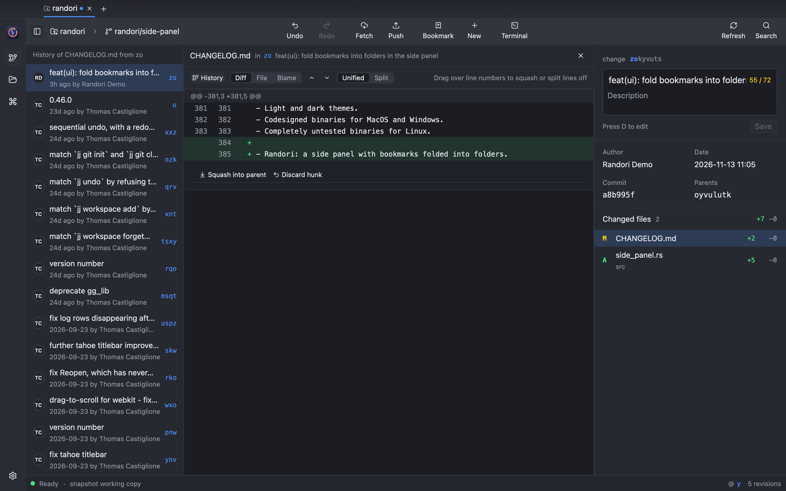
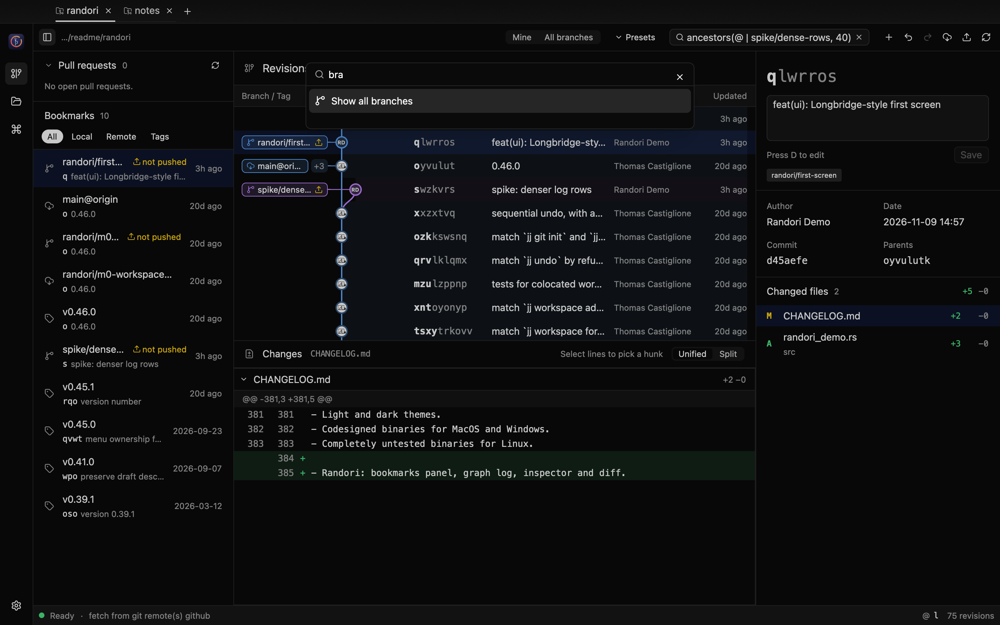

<p align="center">
  
  <br>
  <strong>Randori</strong>
  <br>
  A GPU-accelerated desktop client for <a href="https://github.com/jj-vcs/jj">Jujutsu</a>
</p>


Randori is a native desktop client for the Jujutsu version control system. It
pairs the jj engine from [GG](https://github.com/gulbanana/gg) with a UI built
on [GPUI](https://github.com/zed-industries/zed/tree/main/crates/gpui) and [GPUI Kit](https://github.com/longbridge/gpui-kit),
so the whole application is Rust, rendered on the GPU, with no webview.

The name comes from jujutsu practice: *randori* is free-form sparring, where
you move, split and recombine freely. That is how jj treats history.

> **Status:** early development. Randori reads and edits jj workspaces —
> tabs, graph log, diffs, describe, new, edit, abandon, bookmarks, rebase by
> drag and drop, file and hunk squashes, push, fetch, undo and redo, a command
> palette, appearance settings and the GitHub pull requests of the workspace.
> Conflicts open in your merge tool; an in-app conflict editor is not built yet.

## The window

| Region | What it shows |
| --- | --- |
| Tabs | One tab per jj workspace, like Fork or GitKraken. `+` (or `⌘O`) opens more; the open tabs come back on the next launch |
| Toolbar | The **workspace** and **bookmark** switchers (like GitKraken's repository and branch pickers) and a **conflicts** count, then **Mine / All branches**, **Presets** (`gg.presets`), a **revset** field (Enter to query), and New, Undo, Redo, Fetch, Push, Reload and Terminal |
| Rail | Revisions, Open, the command palette (`⌘P`, as in GitKraken) and Settings (below) |
| Side panel | **Pull requests** of the workspace's GitHub remote (below), then the local and remote bookmarks and tags in the loaded revisions, filtered by kind. Click a bookmark to jump to its revision, right-click to push, rename, track or delete, drag onto a revision to move it there |
| Revisions | Branch / tag, graph, change id, description and author columns, GitKraken style: drag a header's edge to resize a column (double-click it for the default width); the widths are remembered and the graph fits its lanes until you size it. Instead of a time on every row, a hairline and a label ("3 hours ago", "2 weeks ago", "a month ago") mark where each age group starts; the inspector has the exact date. As in GitKraken the layout follows the list's width: wide, the labels have room right of the author; narrower, they sit over the row's end; narrower still, the author column shows avatars only. Each branch keeps one colour from its tip down, and its rows are tinted in it. A revision is its author's round avatar (GitHub picture or initials); a dimmer ring marks immutable revisions, small dots are merges and the hollow ring is the working copy (`@`). Local bookmarks that are not pushed carry an upload mark. Right-click for revision commands; drag a revision onto another to rebase it there |
| Changes | Diff of the selected file, unified or split, with line numbers and word-level highlights. Split puts the parent's version on the left and wraps long lines so both sides stay in view; drag the boundary between them to resize the sides, double-click it to even them. The palette and the View menu do the same from the keyboard; used on a unified diff, they switch it (and the layout diffs open in) to split. Double-click a file (or `⇧⌘D`) for its full view |
| Inspector | The selected revision: change id, an editable description (immutable history stays read-only), author, date, commit, parents and the changed files. Right-click a file to squash it into the parent, discard it, or open it in your diff or merge tool; drag it onto a revision to move it there |
| Terminal | Your shell at the bottom of the tab (below) |
| Status bar | Worker state, the running jj operation and its progress, the last operation, the working copy and the number of loaded revisions |

The **workspace** switcher lists the open tabs, then recently opened
workspaces (`gg.ui.recent-workspaces`, the list GG keeps; off with
`gg.ui.track-recent-workspaces = false`), then **Open…**. The **bookmark**
switcher shows the bookmark nearest to the working copy; jj has no current
branch. Picking another bookmark (`⇧⌘B`) starts a new change on it, `jj new
<bookmark>`, the closest jj has to a checkout. The conflict count is every
mutable revision with a conflict (`conflicts() & mutable()`), loaded or not;
clicking it goes to the next one, switching to **All branches** when it is not
loaded.

After New, Edit or a bookmark switch, Randori snapshots once and checks
whether the new working copy picked up files. That happens when the revision
you move to does not ignore files the previous one ignored, an older
`.gitignore` meeting a build folder: jj then tracks them
([jj #5596](https://github.com/jj-vcs/jj/issues/5596)). A notification lists
them; **Ignore locally** adds them to `.git/info/exclude` (one line per new
folder, never committed) and untracks them, leaving the files on disk.

**By date** lists revisions newest first across branches, like GitKraken's
graph or `git log --date-order`, instead of jj's order, which finishes one
branch before the next. It uses the order jj recorded the commits in, which is
by date in practice and always has parents below their children. The choice
is remembered for every tab (palette: **List revisions by date** / **Group
revisions by branch**). By date, the age labels follow the commit time too, so
a rebased old change sits with the day it was rewritten.

**Mine** is jj's own log (`revsets.log`): your changes that are not in trunk
yet, and trunk. Changes on other people's branches are immutable to jj and stay
out of it. **All branches** shows every visible commit (`all()`), every branch
and tag like GitKraken's graph. The last scope you pick is remembered, and a
revset you type selects neither.

Each tab runs its own jj worker thread (jj-lib is not thread-safe), so a slow
fetch in one workspace never blocks another. Edits made outside Randori, in an
editor or with the jj CLI, show up when the window comes back to the front:
Randori asks jj to snapshot the working copy and reloads, keeping the rows you
had loaded and your scroll position.

### Editing

Every command is one of GG's jj mutations, so the rules are jj's own:
immutable revisions are refused with a warning, `Undo` steps back through the
operation log, and git credentials are asked for when a remote needs them.

| Command | How |
| --- | --- |
| New change on the selection | `N`, toolbar `+`, or the context menu |
| Edit (make it the working copy) | `E` |
| Describe | `D` to focus the inspector editor, `⌘↩` to save |
| Create bookmark | `B`, then type a name and press Enter |
| Abandon | `⌫` / `Delete`, confirmed in a dialog |
| Duplicate, back out | Context menu |
| Rebase | Drag a revision onto its new parent, or press `R`, choose the parent with `↑` `↓` and press Enter |
| Move a bookmark | Drag it from the bookmarks panel onto a revision, or right-click → **Move to…** |
| Squash a file into the parent | Right-click it in the inspector |
| Move a file to any revision | Drag it from the inspector onto the revision, or right-click → **Move to revision…** |
| Discard a file's changes | Right-click it in the inspector, confirmed in a dialog |
| Squash one hunk into the parent | Select lines in the diff, then **Squash hunk into parent** |
| Resolve a conflict | Right-click the conflicted file → **Resolve in merge tool** (`ui.merge-editor`) |
| Anything else | `⌘P` opens the command palette |
| Push | `⌘⇧P` pushes the selection's bookmarks (an untracked bookmark goes to `origin`, or the only remote) |
| Fetch | `⌘⇧F` fetches every remote |
| Undo / redo | `⌘Z` / `⌘⇧Z` in the revision list |

### Full file view

Double-clicking a changed file, the expand button above the diff, `⇧⌘D`, or
**Open full view**, **Blame** and **File history** in the file's context menu
open the file on its own, in the place of the revisions and the diff (`Esc`
goes back):

| Part | What it shows |
| --- | --- |
| Diff | The file's diff in that revision, unified or split. Under every hunk, **Squash into parent** and **Discard hunk** (the parent's lines back; `⌘Z` undoes). `⌥↑` `⌥↓` move between changes |
| File | The whole file as it is in that revision, with line numbers |
| Blame | Each line with the revision that last changed it, the way `jj file annotate` finds it; click a revision to see its diff of the file. It is computed on a load of its own, so the tab stays usable while a long history is walked |
| History | Every revision that changed the file among the ancestors of the one you opened, in the side panel's place; pick one to see the file as it was there |



### Terminal

The toolbar's terminal button or `` ⌃` `` opens your shell at the bottom of the
tab, in the workspace's folder, as GitKraken does. It is a real terminal: your
login shell with its prompt and aliases, colours, full-screen programs (`less`,
`vim`, `jj split -i`), scrollback, a mouse selection to copy, and input methods
for Korean, Japanese or Chinese. The shell keeps running while the panel is
hidden; when it exits, Enter starts a new one.

When a command records a jj operation (`jj new`, `jj squash`, `jj git fetch`,
even a snapshot by `jj st`), the revisions reload on their own. In a
colocated repository so does a `git` command that moves a branch or `HEAD`
(`git commit`, `git checkout`): Randori snapshots to import it, so this needs
snapshots on (**Snapshot when Randori comes to the front** set to Automatic or
Always; with Never, the change shows after the next jj command). Reload
(`⌘R`) also picks up what the jj CLI, or `git` in a colocated repository, did
elsewhere.

| Keys | In the terminal |
| --- | --- |
| `⌘C` / `⌘V` (`Ctrl+Shift+C` / `Ctrl+Shift+V`) | Copy the selection / paste (bracketed, so pasted lines do not run one by one) |
| `⌘K` | Clear the screen and the scrollback |
| `Esc`, `Ctrl` keys | Go to the shell, not to Randori |

Powerline prompt arrows are drawn by the terminal itself, so they need no
patched font; other prompt symbols use an installed Nerd Font when there is
one.

### Settings

The rail's Settings menu. Display settings are saved with Randori's session;
the jj ones are the `[gg]` keys GG reads, written to your jj user config (the
file `jj config set --user` edits), so the jj CLI and GG agree with Randori.
Changes apply to open tabs at once.

| Setting | Saved in | Effect |
| --- | --- | --- |
| Appearance | session | Light, dark or follow the system |
| Diffs open as | session | Unified or split; the diff header's switch changes it too, in the changes panel and the full file view alike. The split's divider position is saved too |
| Snapshot when Randori comes to the front | `gg.queries.auto-snapshot` | Automatic (jj's default: off in repositories over `gg.queries.large-repo-heuristic`, 100k commits), always or never |
| Mark bookmarks that are not pushed | `gg.ui.mark-unpushed-bookmarks` | Upload mark on local bookmarks that moved since their push, or that no remote tracks |
| Pull requests and avatars | session | Turns the GitHub section and avatar requests off |
| Pull request refresh | session | Every minute, 5 or 15 minutes, or only when asked |

**Presets** lists GG's revset presets: the `[gg.presets]` table of your jj
config, or GG's own (tracked bookmarks, remote bookmarks, all revisions) when
it is empty. Kebab-case names become titles (`local-bookmarks` → "Local
Bookmarks").

### Pull requests

When a workspace has a GitHub remote (`origin`, or else the first remote on
github.com or a GitHub Enterprise host), the side panel lists its open pull
requests, newest activity first: author, number and title, head → base branch,
the review decision and the checks of the head commit. Click one to select its
head revision (switching to **All branches** if it is not loaded), or open it on
GitHub. The list refreshes on the interval chosen in Settings (every minute by
default), when the window comes back to the front (at most every 30 seconds)
and from **Refresh pull requests** in the palette.
The same query brings the avatars of recent authors on the default branch and
on the pull requests' base branches.

Randori uses the token you already have: `GH_TOKEN` or `GITHUB_TOKEN`
(`GH_ENTERPRISE_TOKEN` for Enterprise hosts), or else the GitHub CLI's
(`gh auth token`). It is kept in memory, never written or logged, and sent only
to that host's GraphQL API over HTTPS. Without one the section shows how to
sign in (`gh auth login`); nothing else needs it.




### Keyboard

| Keys | Where | Action |
| --- | --- | --- |
| `↑` `↓` / `k` `j` | Revisions | Select the previous / next revision; the next page loads at the end |
| `Home` / `End` | Revisions | First / last loaded revision |
| `R` | Revisions | Pick a new parent for the selection (Enter applies, Esc cancels; other commands wait until you do) |
| `/` | Revisions | Edit the revset |
| `⌘L` (`Ctrl+L`) | Workspace | Edit the revset |
| `Esc` | Workspace | Back to the revision list |
| `⌘R` (`Ctrl+R`) | Workspace | Reload, with what jj recorded outside Randori |
| `` ⌃` `` | Workspace | Show or hide the terminal |
| `⌘B` (`Ctrl+B`) | Workspace | Show or hide the bookmarks panel |
| `⌘O` (`Ctrl+O`) | Window | Open a workspace in a new tab |
| `⌘W` (`Ctrl+W`) | Window | Close the tab; with no tab open, close the window |
| `⌘Q` (`Ctrl+Q`) | Anywhere | Quit (asks first when descriptions are unsaved). Closing the window quits too |
| `Ctrl+Tab` / `Ctrl+Shift+Tab` | Window | Next / previous tab |
| `⌘P` (`Ctrl+P`) | Window | Command palette |
| `⇧⌘D` (`Ctrl+Shift+D`) | Workspace | Full view of the selected file |
| `⇧⌘B` (`Ctrl+Shift+B`) | Workspace | Start a new change on a bookmark |
| `⌥↑` / `⌥↓`, `[` / `]`, `Esc` | Full view | Previous / next change, previous / next file, back to the revisions |

On Linux and Windows, `⌘` is `Ctrl`. On macOS the menu bar has the same
commands (Randori, File, View, Window), with Hide (`⌘H`) and Services.

The layout follows the professional workstation style of
[Longbridge Pro](https://longbridge.com/desktop), the application GPUI Kit was
extracted from: hairline-separated panels instead of cards, a narrow navigation
rail, dense rows with stable columns, and an inspector beside the work area.
Colors come only from theme tokens, so the light theme works unchanged.

<details>
<summary>Light theme</summary>


</details>

## Running

Randori needs Rust 1.99.1, pinned in `rust-toolchain.toml` (jj-lib 0.46 and
GPUI both require a recent compiler; rustup installs it on first build), and
git 2.42 or newer for jj's git operations. If an older git comes first on
`PATH`, point jj at a newer one; Randori reads the same setting:

```sh
jj config set --user git.executable-path /opt/homebrew/bin/git
```

### From source

```sh
cargo run -- /path/to/workspace /path/to/another   # each opens in a tab
```

This is the development build: unoptimized, and a bare executable. Don't
double-click `target/*/randori` in Finder; macOS runs a bare executable inside a
Terminal window. Build the app bundle below to launch Randori like any other
Mac app.

### As a Mac app

```sh
script/bundle-macos.sh           # target/release/Randori.app
script/bundle-macos.sh --dmg     # also target/release/Randori.dmg (drag to Applications)
open target/release/Randori.app
```

The script needs only cargo and the macOS command-line tools (`codesign`,
`hdiutil`): it builds the release binary, writes `Info.plist`, adds the icon
and signs the bundle ad hoc, which is enough to run it on your own Mac. Giving
the app to other people needs a Developer ID signature and notarization
instead; Gatekeeper refuses ad-hoc signed apps downloaded from the internet.

The release profile (`Cargo.toml`) uses thin LTO, a single codegen unit and
strips symbols, and the app embeds only the icons it draws (`assets.rs`)
instead of the whole Lucide set:

| Build | Size |
| --- | --- |
| Release, default profile, every icon | 47.7 MB executable |
| Release, used icons only | 46.7 MB executable |
| Release, LTO + `codegen-units = 1` + strip | 29.4 MB executable |
| The same, with the HTTP client for GitHub | 32.3 MB executable |
| `Randori.dmg` (compressed disk image) | 15.8 MB |

A release build takes about three minutes on an M-series Mac; `cargo run`
stays fast because the debug profile is unchanged.

Opening a folder that is not a jj repository offers **Create a jj repository
here** (colocated with git when the folder already is one) and **Try again**
(`⌘R`).

| Option | Effect |
| --- | --- |
| `--revset <query>` | Start with this revset instead of the workspace default |
| `--light` | Use the light theme |
| `--check` | Open the workspace through the worker, print a summary and exit (no window) |
| `--select-row <n>` | Select the n-th log row once loaded |
| `--screenshot <png>` | Render the first screen offscreen and exit; needs `--features screenshot` |
| `--keys <k1,k2,…>` | With `--screenshot`: press these keys first through the real key bindings, e.g. `down,j,end`; `action:randori::SquashFile` runs an action the way a menu item does; `click:X;Y`, `rclick:X;Y`, `dblclick:X;Y` and `drag:X1;Y1;X2;Y2` use the mouse at window points |

The screenshots above were produced with:

```sh
cargo run -p randori --features screenshot -- \
  --revset 'ancestors(@ | spike/dense-rows, 40)' --select-row 1 \
  --screenshot doc/randori/first-screen.png /path/to/workspace
```

The sample workspaces are a clone of this repository with two extra changes and
a small notes repository, made under a placeholder identity
(`JJ_USER="Randori Demo"`). Screenshot runs never touch your saved tabs.

## How it is built

```text
crates/randori   app_view       tabs, rail, palette, settings, saved session
                 repo_view      one workspace: state, loading, selection, actions, keys
                   model        rows, refs, files and diffs built from worker data
                   log_list     graph log rows and header
                   panels       toolbar, bookmarks panel, status bar, layout
                   inspector    revision details, changed files, diff
                   ops          jj mutations (new, describe, abandon, push, rebase, …)
                   pick         choosing a target revision from the keyboard
                   pulls        the pull requests section
                   focus        a file's full view: diff, file, blame, history
                   switcher     workspace and bookmark switchers, conflict count
                   split        the movable divider of split diffs
                   terminal_panel  the terminal at the bottom of a tab
                   dnd, menus   drag payloads, context menus
                 graph          graph lanes, branch colours and avatars per virtual-list row
                 github         GitHub remotes, token lookup, pull request and avatar query
                 terminal       a shell in a PTY (alacritty_terminal) drawn with GPUI
                 worker         one jj worker thread per tab
                 assets         embedded icons
      │  SessionEvent requests over a channel per tab, push events back through EventSink
      ▼
src/worker       GG's jj engine (jj-lib), one worker thread per tab
src/messages     request and response types shared with the UI
```

- jj-lib is not thread-safe, so each tab owns a worker thread that owns the
  repository. The UI sends requests and awaits replies on a background executor.
- GG's worker lays out the graph (lane and row of every node and edge). Randori
  draws it per row of a virtual list, clipped to the row, so long histories
  stay fast. Graph geometry and row height are in `rem`, so they scale with the
  interface.
- The root package, `randori-core`, is GG's jj engine (`src/worker`,
  `src/messages`, `src/config`, `src/askpass.rs`). GG's Tauri app, web mode and
  Svelte frontend are not part of Randori; GG's documentation is kept in
  [`doc/gg/`](doc/gg/).
- gpui-kit comes from Randori's fork, `jeonsu0609/gpui-kit`: the 0.9.0
  release plus a ratio for the two sides of a split diff, through
  `[patch.crates-io]`. What changed and how to update it:
  [`doc/randori/gpui-kit-patch.md`](doc/randori/gpui-kit-patch.md).

## Based on GG

Randori starts from [GG — Gui for JJ](https://github.com/gulbanana/gg) by
Thomas Castiglione and contributors, and keeps its full history. The jj
engine in `src/` is theirs; Randori replaced GG's Tauri and Svelte frontend
with GPUI and removed it from this repository. GG's own documentation lives in
[`doc/gg/`](doc/gg/), including its [README](doc/gg/README.md),
[design notes](doc/gg/DESIGN.md), [changelog](doc/gg/CHANGELOG.md) and
[contributing guide](doc/gg/CONTRIBUTING.md). `AGENTS.md` is the guide for
working on Randori itself.

## License

Apache-2.0, the same as GG. See [LICENSE](LICENSE).
