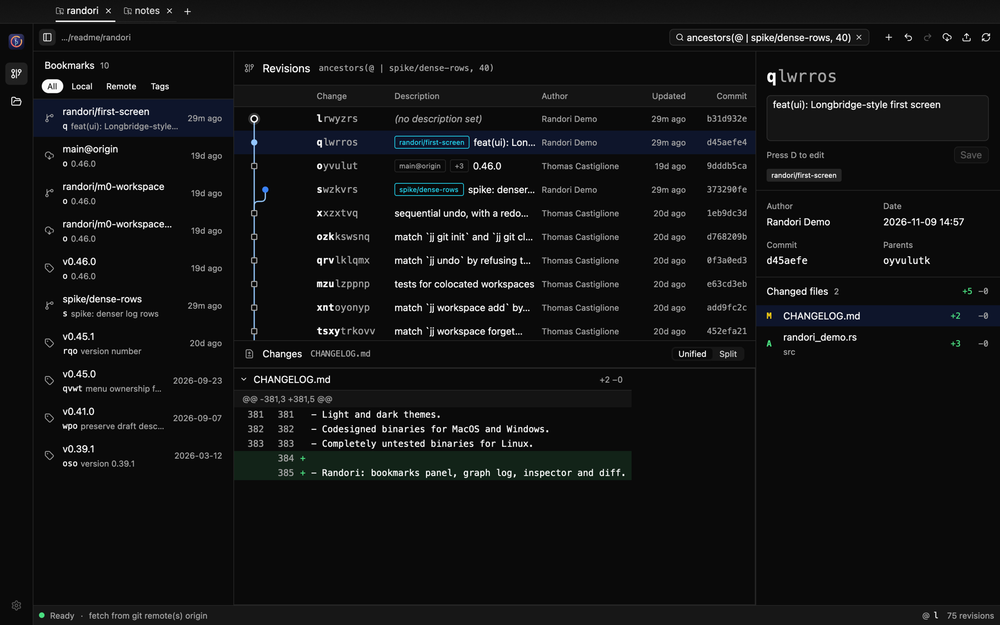
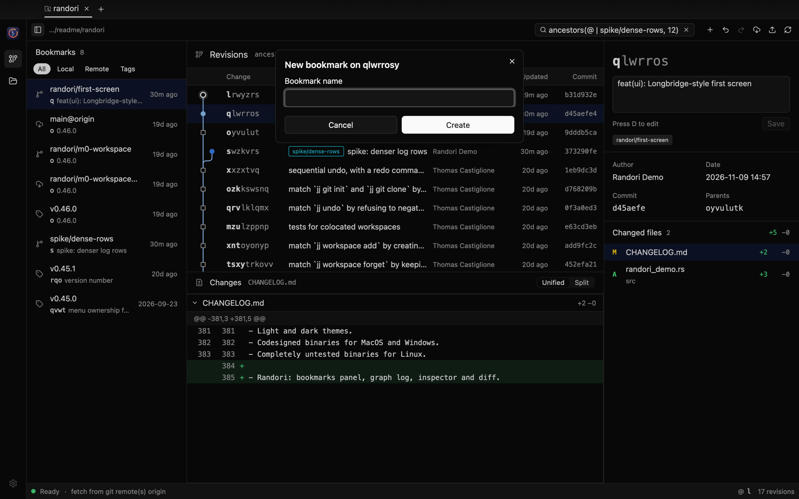
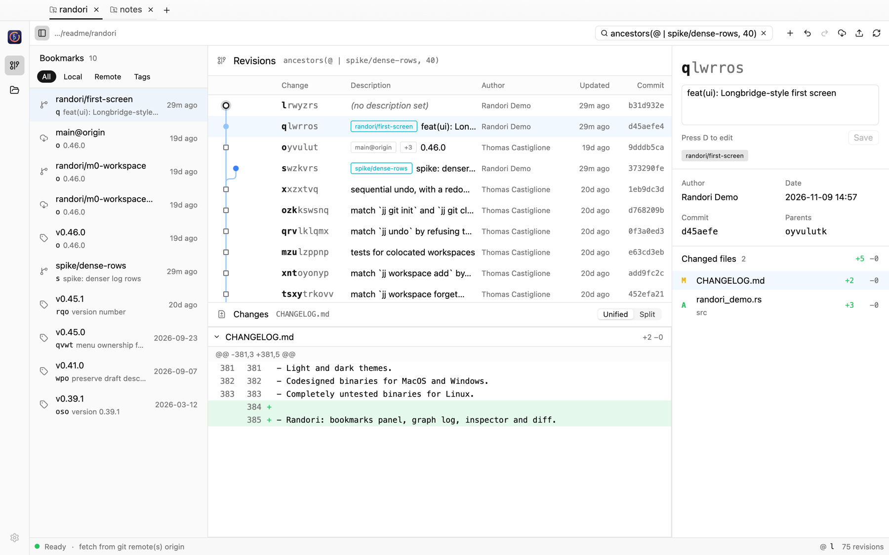

<p align="center">
  
  <br>
  <strong>Randori</strong>
  <br>
  A GPU-accelerated desktop client for <a href="https://github.com/jj-vcs/jj">Jujutsu</a>
</p>



Randori is a native desktop client for the Jujutsu version control system. It
pairs the jj engine from [GG](https://github.com/gulbanana/gg) with a UI built
on [GPUI](https://github.com/zed-industries/zed/tree/main/crates/gpui) and [GPUI Kit](https://github.com/longbridge/gpui-kit),
so the whole application is Rust, rendered on the GPU, with no webview.

The name comes from jujutsu practice: *randori* is free-form sparring, where
you move, split and recombine freely. That is how jj treats history.

> **Status:** early development. Randori reads and edits jj workspaces —
> tabs, graph log, diffs, describe, new, edit, abandon, bookmarks, rebase by
> drag and drop, push, fetch, undo and redo. Hunk-level moves, conflict
> resolution and settings are not built yet.

## The window

| Region | What it shows |
| --- | --- |
| Tabs | One tab per jj workspace, like Fork or GitKraken. `+` (or `⌘O`) opens more; the open tabs come back on the next launch |
| Toolbar | Workspace path, a **revset** field (Enter to query), and New, Undo, Redo, Fetch, Push, Reload |
| Rail | App navigation and Open; settings are not built yet |
| Bookmarks | Local and remote bookmarks and tags in the loaded revisions, filtered by kind. Click to jump to the revision, right-click to push, rename, track or delete, drag onto a revision to move it there |
| Revisions | The commit graph with fixed columns: change id, bookmarks and description, author, relative time, commit id. The hollow ring is the working copy (`@`); squares are immutable revisions. Right-click for revision commands; drag a revision onto another to rebase it there |
| Changes | Diff of the selected file, unified or split, with line numbers and word-level highlights |
| Inspector | The selected revision: change id, an editable description (immutable history stays read-only), author, date, commit, parents and the changed files |
| Status bar | Worker state, the running jj operation and its progress, the last operation, the working copy and the number of loaded revisions |

Each tab runs its own jj worker thread (jj-lib is not thread-safe), so a slow
fetch in one workspace never blocks another. Edits made outside Randori, in an
editor or with the jj CLI, show up when the window comes back to the front:
Randori asks jj to snapshot the working copy and reloads, keeping the rows you
had loaded and your scroll position.

### Editing

Every command is one of GG's jj mutations, so the rules are jj's own:
immutable revisions are refused with a warning, `Undo` steps back through the
operation log, and git credentials are asked for when a remote needs them.

| Command | How |
| --- | --- |
| New change on the selection | `N`, toolbar `+`, or the context menu |
| Edit (make it the working copy) | `E` |
| Describe | `D` to focus the inspector editor, `⌘↩` to save |
| Create bookmark | `B`, then type a name and press Enter |
| Abandon | `⌫` / `Delete`, confirmed in a dialog |
| Duplicate, back out | Context menu |
| Rebase | Drag a revision onto its new parent |
| Move a bookmark | Drag it from the bookmarks panel onto a revision |
| Push | `⌘⇧P` pushes the selection's bookmarks (an untracked bookmark goes to `origin`, or the only remote) |
| Fetch | `⌘⇧F` fetches every remote |
| Undo / redo | `⌘Z` / `⌘⇧Z` in the revision list |



### Keyboard

| Keys | Where | Action |
| --- | --- | --- |
| `↑` `↓` / `k` `j` | Revisions | Select the previous / next revision; the next page loads at the end |
| `Home` / `End` | Revisions | First / last loaded revision |
| `/` | Revisions | Edit the revset |
| `⌘L` (`Ctrl+L`) | Workspace | Edit the revset |
| `Esc` | Workspace | Back to the revision list |
| `⌘R` (`Ctrl+R`) | Workspace | Reload |
| `⌘B` (`Ctrl+B`) | Workspace | Show or hide the bookmarks panel |
| `⌘O` (`Ctrl+O`) | Window | Open a workspace in a new tab |
| `⌘W` (`Ctrl+W`) | Window | Close the tab |
| `Ctrl+Tab` / `Ctrl+Shift+Tab` | Window | Next / previous tab |

On Linux and Windows, `⌘` is `Ctrl`.

The layout follows the professional workstation style of
[Longbridge Pro](https://longbridge.com/desktop), the application GPUI Kit was
extracted from: hairline-separated panels instead of cards, a narrow navigation
rail, dense rows with stable columns, and an inspector beside the work area.
Colors come only from theme tokens, so the light theme works unchanged.

<details>
<summary>Light theme</summary>



</details>

## Running

Randori needs Rust 1.99.1, pinned in `rust-toolchain.toml` (jj-lib 0.46 and
GPUI both require a recent compiler; rustup installs it on first build), and
git 2.42 or newer for jj's git operations. If an older git comes first on
`PATH`, point jj at a newer one; Randori reads the same setting:

```sh
jj config set --user git.executable-path /opt/homebrew/bin/git
```

`crates/randori` is its own Cargo workspace with its own `Cargo.lock`, so GPUI's
dependencies never change the versions GG's Tauri app is locked to. It shares
the root `target/` directory.

```sh
cd crates/randori
cargo run -- /path/to/workspace /path/to/another   # each opens in a tab
```

| Option | Effect |
| --- | --- |
| `--revset <query>` | Start with this revset instead of the workspace default |
| `--light` | Use the light theme |
| `--check` | Open the workspace through the worker, print a summary and exit (no window) |
| `--select-row <n>` | Select the n-th log row once loaded |
| `--screenshot <png>` | Render the first screen offscreen and exit; needs `--features screenshot` |
| `--keys <k1,k2,…>` | With `--screenshot`: press these keys first through the real key bindings, e.g. `down,j,end` |

The screenshots above were produced with:

```sh
cd crates/randori
cargo run --features screenshot -- \
  --revset 'ancestors(@ | spike/dense-rows, 40)' --select-row 1 \
  --screenshot ../../doc/randori/first-screen.png /path/to/workspace
```

The sample workspaces are a clone of this repository with two extra changes and
a small notes repository, made under a placeholder identity
(`JJ_USER="Randori Demo"`). Screenshot runs never touch your saved tabs.

## How it is built

```text
crates/randori   app_view: tabs, rail, open/close, saved session
                 repo_view: toolbar, bookmarks, graph log, diff, inspector, status bar
                 repo_view/ops: jj mutations (new, describe, abandon, push, rebase, …)
      │  SessionEvent requests over a channel per tab, push events back through EventSink
      ▼
src/worker       GG's jj engine (jj-lib), one worker thread per window
src/messages     request and response types shared with the UI
```

- jj-lib is not thread-safe, so each window owns a worker thread that owns the
  repository. The UI sends requests and awaits replies on a background executor.
- GG's worker lays out the graph (lane and row of every node and edge). Randori
  draws it per row of a virtual list, clipped to the row, so long histories
  stay fast. Graph geometry and row height are in `rem`, so they scale with the
  interface.
- The root crate is still GG. Its Tauri application, web mode and Svelte
  frontend sit behind the default `gui` feature, which Randori turns off.
  Changes to GG's files are marked with `Randori:` comments.

## Based on GG

Randori starts from [GG — Gui for JJ](https://github.com/gulbanana/gg) by
Thomas Castiglione and contributors, and keeps its full history. The jj
engine in `src/` is theirs; Randori replaces the Tauri/Svelte frontend with
GPUI. GG's own documentation now lives in [`doc/gg/`](doc/gg/), including its
[README](doc/gg/README.md), [changelog](doc/gg/CHANGELOG.md) and
[contributing guide](doc/gg/CONTRIBUTING.md). `AGENTS.md` describes the GG
backend and its original Tauri app.

## License

Apache-2.0, the same as GG. See [LICENSE](LICENSE).
